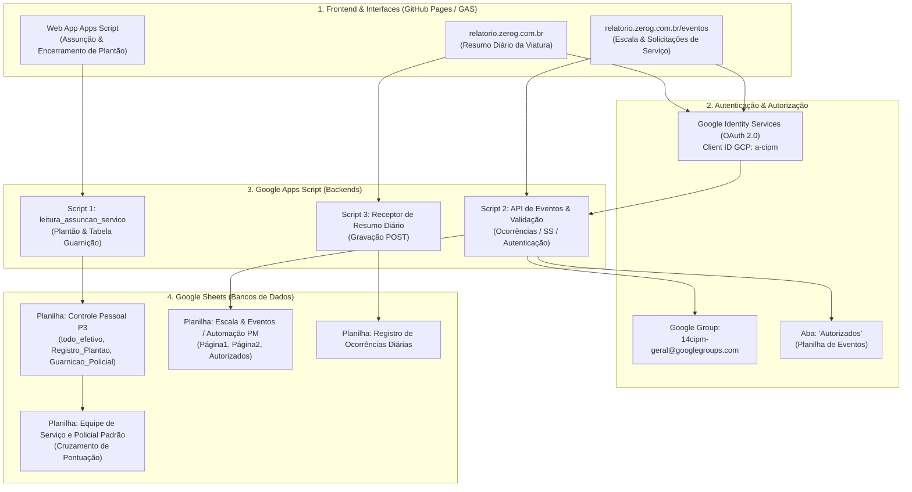

# Mapeamento do Ecossistema Integrado – 14ª CIPM (PMMS)

Documento técnico de referência contendo o inventário de todas as **planilhas**, **scripts (Apps Script)**, **endpoints**, **regras de negócio** e **credenciais de segurança** que compõem o ecossistema do site [relatorio.zerog.com.br](https://relatorio.zerog.com.br), bem como o roteiro para replicação em outras unidades policiais militares.

---

## 1. Visão Geral da Arquitetura

O ecossistema é composto por quatro camadas integradas:

---

## 2. Inventário de Planilhas Google (Google Sheets)

### 📊 Planilha 1: `Controle Pessoal P3`
* **Finalidade:** Base oficial de recursos humanos e cadastro funcional do efetivo da unidade (dados pessoais e administrativos).
* **ID da Planilha:** `189VFhZSpn9VpruRjrNOFXtn8JbZ8wIkdWmkLxaL16Q0`
* **Link de Acesso:** [Abrir Planilha Controle Pessoal P3](https://docs.google.com/spreadsheets/d/189VFhZSpn9VpruRjrNOFXtn8JbZ8wIkdWmkLxaL16Q0/edit?gid=0#gid=0)
* **Abas:**
  1. **`todo_efetivo`** *(Fonte Primária de Dados)*: Matrícula, Graduação, Lotação, Nome de Guerra, Nome Completo, CPF.
  2. **`efetivo_mundonovo`**, **`VENCIDOS`**: Controles internos do P3.

---

### 📊 Planilha 2: `Equipe de Serviço e Policial Padrão`
* **Finalidade:** Repositório operacional de serviço da unidade, controle de viaturas, histórico de plantões e motor de cálculo do programa "Policial Padrão".
* **ID da Planilha:** `18kLtJLfhy7jijao-VTz1t0lpkpYq00YyuPE_7yVefmA`
* **Link de Acesso:** [Abrir Planilha Equipe de Serviço e Policial Padrão](https://docs.google.com/spreadsheets/d/18kLtJLfhy7jijao-VTz1t0lpkpYq00YyuPE_7yVefmA/edit?gid=0#gid=0)
* **Abas e Estrutura:**
  1. **`todo_efetivo`**: Cópia/espelho do efetivo da unidade para alimentar os formulários operacionais.
  2. **`Registro_Plantao`**: 1 linha por turno/viatura (ID_Turno, Data, Hora, Fração, Posto, Placa, Prefixo, KM, Equipe, Produtividade).
  3. **`Guarnicao_Policial`**: Tabela-ponte vertical (1 linha por policial por turno com flag `Pontua_Equipe_VTR`). Cruza os registros com os dados de produtividade para consolidar os pontos de cada policial.

---

### 📊 Planilha 3: `Escala & Eventos / Automação PM (Solicitações de Serviço - SS)`
* **Finalidade:** Armazena o banco de dados de eventos, patrulhamento escolar e a lista de exceções de e-mails autorizados.
* **Script Vinculado:** Script 2 (`AKfycbwHoaSSDn417xzEBtawLg_wTjC3saLZ4KFSCKlIdM-M8ZDldH3S_Rnx8PL-VxqEbzvv`)
* **Abas:**
  1. **`Página1`**: Dados das Solicitações de Serviço (SS) e escalas geradas (Data, Hora, Evento/Escola, Arquivo/Link, Atividade).
  2. **`Página2`**: Matriz de horários e pesos para o sorteio do policiamento escolar.
  3. **`Autorizados`**: Lista de e-mails Gmail autorizados a acessar o ecossistema, além dos integrantes do Google Groups.

---

### 📊 Planilha 4: `Registro de Ocorrências Diárias (Formulário Raiz)`
* **Finalidade:** Recebe o histórico bruto de envios de produtividade submetidos pelo formulário de ocorrências da página inicial.
* **Script Vinculado:** Script 3 (`AKfycbzH1s1BBWHp_PtuUwNKNS2Ys3dwS5-h2o6hrFqWPYeoZjGL-tx_w-4bLgEUV2lx04pr`)

---

## 3. Inventário de Scripts (Google Apps Script)

| Script | Finalidade | ID / URL de Execução | Sincronização Local |
|---|---|---|---|
| **`leitura_assuncao_servico`** | Backend do formulário de Assunção e Encerramento (Web App). Grava em `Registro_Plantao` e `Guarnicao_Policial`. | ID: `1w4Dh_aVw_RTF1yQPe61cvpK4YS1DA6m7KDF-im7WSgr4X0zIP1rOABCZ` URL: `https://script.google.com/macros/s/AKfycbxrsLCvIjjtNhvok4eSDc01lUkwmsWHzv-lM9mElwbo3xbUWQNu08yPbUJGSnO07jE/exec` | Gerenciado via CLI **`clasp`** na pasta `scripts/leitura_assuncao_servico/` |
| **`Backend Eventos & Auth`** | Fornece API JSON de eventos/SS e valida autorização de e-mails via Google Groups ou aba `Autorizados`. | URL: `https://script.google.com/macros/s/AKfycbwHoaSSDn417xzEBtawLg_wTjC3saLZ4KFSCKlIdM-M8ZDldH3S_Rnx8PL-VxqEbzvv/exec` | Código de referência arquivado em `contexto/codigo.gs` |
| **`Receptor Resumo Diário`** | Recebe submissões POST do formulário principal de ocorrências (`index.html`) e grava linha na planilha. | URL: `https://script.google.com/macros/s/AKfycbzH1s1BBWHp_PtuUwNKNS2Ys3dwS5-h2o6hrFqWPYeoZjGL-tx_w-4bLgEUV2lx04pr/exec` | Configurado diretamente no `index.html` |

---

## 4. Controle de Acesso e Autenticação (Google Identity)

O ecossistema implementa **Single Sign-On (SSO)** entre todas as páginas sob o domínio `relatorio.zerog.com.br`:

* **Google Cloud Project (GCP):** `a-cipm`
* **Client ID OAuth 2.0:**  
  `81878847414-f2lt8p7fbkjkh46julqdgfuhfcvau22o.apps.googleusercontent.com`
* **Origens JavaScript Autorizadas:**  
  - `https://relatorio.zerog.com.br`  
  - `https://projectselus.github.io`
* **Grupo Oficial de Membros:**  
  👉 **`14cipm-geral@googlegroups.com`** *(Qualquer e-mail membro tem acesso liberado)*.
* **Aba de Exceções Extras:**  
  👉 Aba **`Autorizados`** na planilha de Eventos.
* **Persistência no Celular/Navegador (`localStorage` compartilhado):**
  - `pmms_id_token`: Token JWT autenticado pelo Google.
  - `pmms_user_email`: E-mail verificado do militar.
  - `pmms_user_name`: Nome de exibição.
  - `pmms_dispositivo_autorizado`: Flag `'true'` que evita bloqueio da tela em recarregamentos.

---

## 5. Padrões Operacionais das Frações (14ª CIPM)

Configurados internamente nos formulários para agilizar o preenchimento automático das viaturas e telefones de serviço:

| Fração / Pelotão | Municípios / Localidades | Viatura Padrão (Placa) | Prefixo | Telefone Funcional |
|---|---|---|---|---|
| **SEDE / MUNDO NOVO** | Mundo Novo | `REW-3B07` | `10.3184` | (67) 99268-5540 |
| **2º PEL / IGUATEMI** | Iguatemi | `SMK-3C53` | `10.3757` | (67) 99211-5349 |
| **3º PEL / JAPORÃ** | Japorã | `SMK-7A60` | `10.3747` | (67) 99282-0703 |
| **4º PEL / ELDORADO** | Eldorado, Porto Morumbi | `UGY-3H55` | `10.3975` | (67) 99217-3603 |
| **GPM / PORTO MORUMBI**| Porto Morumbi, Eldorado | `UGY-3H55` | `10.3975` | (67) 99217-3603 |

---

## 6. Guia de Transposição para Outras Unidades Policiais (Passo a Passo)

Para replicar este ecossistema em outra OPM (Batalhão, Companhia Independente, Pelotão):

### Passo 1: Google Cloud (OAuth 2.0)
1. Crie um projeto no [Google Cloud Console](https://console.cloud.google.com/).
2. Em **APIs e Serviços > Tela de permissão OAuth**, configure o nome da OPM.
3. Em **Credenciais > Criar Credenciais > ID do cliente OAuth**:
   - Tipo de aplicativo: **Aplicativo da Web**.
   - Adicione o domínio da sua unidade em **Origens JavaScript autorizadas** (ex: `https://relatorio.suaopm.com.br` ou `https://sua-organizacao.github.io`).
4. Guarde o `Client ID` gerado.

### Passo 2: Google Groups da Unidade
1. Crie um grupo no [Google Groups](https://groups.google.com/) com todos os policiais da unidade (ex: `suaopm-geral@googlegroups.com`).
2. Garanta que a conta administradora da OPM seja proprietária do grupo.

### Passo 3: Duplicar as Planilhas Modelo
1. Crie uma cópia da planilha `Controle Pessoal P3`:
   - Popule a aba `todo_efetivo` com os policiais da sua OPM (Graduação, Fração/Cidade, Nome de Guerra).
2. Crie uma cópia da planilha de `Escala & Eventos`:
   - Mantenha as abas `Página1`, `Página2` e `Autorizados`.
3. Guarde os IDs das novas planilhas.

### Passo 4: Configurar os Scripts no Google Apps Script
1. No script `leitura_assuncao_servico`:
   - Atualize a constante `ID_PLANILHA_CONTROLE` com o ID da nova planilha de controle da sua OPM.
   - Atualize a constante `PADROES_FRACAO` no `Index.html` com as viaturas, prefixos e telefones das cidades da sua unidade.
   - Implante como **App da Web** (`Executar como: Eu`, `Quem pode acessar: Qualquer pessoa`).
2. No script de `Eventos`:
   - Atualize `CLIENT_ID_GOOGLE` e `EMAIL_GOOGLE_GROUP` com os novos valores da OPM.
   - Implante como App da Web.

### Passo 5: Atualizar o Repositório GitHub
1. Faça um Fork ou Clone deste repositório.
2. Substitua o `CLIENT_ID_GOOGLE`, `SCRIPT_API_URL` e `GOOGLE_SCRIPT_URL` no `index.html` e `eventos/index.html`.
3. Configure o GitHub Pages na branch `main`.
4. (Opcional) Configure seu domínio próprio no arquivo `CNAME`.
